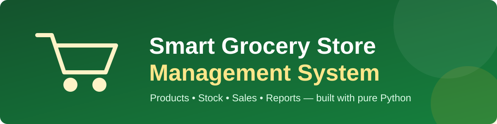
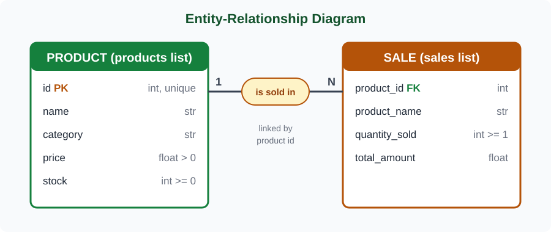
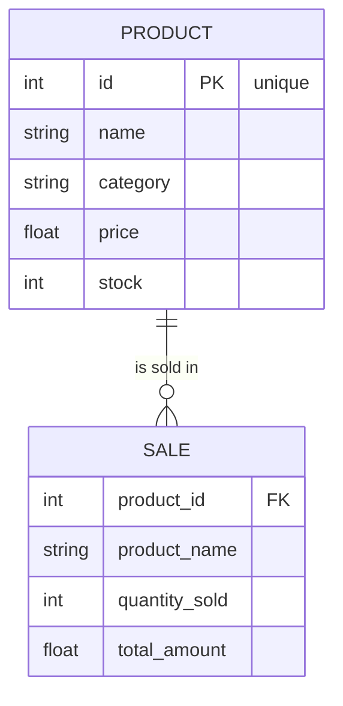
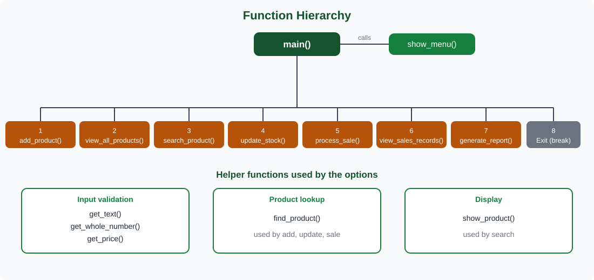

<div align="center">



<br>


**A simple console application that helps a local grocery store manage products, stock, sales and reports.**

</div>

---

## 📑 Table of Contents

1. [Overview](#-overview)
2. [Features at a Glance](#-features-at-a-glance)
3. [How to Run](#-how-to-run)
4. [Menu](#-menu)
5. [Task-by-Task Description](#-task-by-task-description)
6. [Data Structures](#-data-structures)
7. [ER Diagram & Data Hierarchy](#-er-diagram--data-hierarchy)
8. [Code Explanation & Function Hierarchy](#-code-explanation--function-hierarchy)
9. [Input Validation Rules](#-input-validation-rules)
10. [Sample Run](#-sample-run)
11. [Testing](#-testing)
12. [Requirements Checklist](#-requirements-checklist)
13. [Project Structure](#-project-structure)

---

## 🛒 Overview

The store owner needs to keep records of **products, prices, available stock and sales**.
This program does that with plain Python: **lists of dictionaries** for storage, **loops** to process records, **conditionals** to choose operations and **custom functions** to keep the code organised.

It runs from a menu and keeps running until the user chooses **Exit**.

> 💡 **Design goal:** simple, easy-to-read logic. No classes, no files, no external libraries, only the basics of an introductory Python course.

---

## ✨ Features at a Glance

| # | Feature | What it does |
|---|---------|--------------|
| 1 | ➕ **Add New Product** | Reads product details, blocks duplicate IDs, stores a dictionary with `.append()` |
| 2 | 📋 **View All Products** | Prints a table of ID, name, category, price and stock |
| 3 | 🔍 **Search Product** | Finds products by **ID** or **name** (case-insensitive, partial names work) |
| 4 | 📦 **Update Stock** | Adds stock to a product *or* sets an exact quantity, then shows the result |
| 5 | 💰 **Process Sale** | Checks product and stock, calculates total, deducts stock, prints a summary |
| 6 | 🧾 **View Sales Records** | Lists every completed sale |
| 7 | 📊 **Store Report** | Totals, revenue, low-stock items, highest and lowest priced products |
| 8 | 🚪 **Exit** | Ends the program politely |

---

## ▶️ How to Run

**Requirements:** Python 3.8 or newer. No extra packages.

```bash
# 1. Unzip the project and open the folder
cd smart_grocery_store

# 2. Run the program
python grocery_store.py          # on some systems: python3 grocery_store.py
```

The store starts with four sample products (Milk, Bread, Eggs, Rice) so every option can be tried immediately.

---

## 📋 Menu

```text
====================================
SMART GROCERY STORE SYSTEM
====================================

1. Add New Product
2. View All Products
3. Search Product
4. Update Product Stock
5. Process Customer Sale
6. View Sales Records
7. Generate Store Report
8. Exit

Enter your choice:
```

Any choice other than `1`-`8` shows an error message and the menu appears again.

---

## 📝 Task-by-Task Description

### 1️⃣ Product Management
Products live in a list called `products`. Each product is a dictionary with the keys `id`, `name`, `category`, `price`, `stock`.

### 2️⃣ Add New Products: `add_product()`
1. Asks for the **Product ID** first and checks the list with `find_product()`.
2. If the ID already exists, it prints *"This Product ID already exists"* and nothing is added.
3. Otherwise it asks for name, category, price and stock, builds a dictionary and adds it with `products.append(...)`.

### 3️⃣ Display All Products: `view_all_products()`
Loops through `products` and prints one aligned row per product. Shows *"No products available"* if the list is empty.

### 4️⃣ Search Products: `search_product()`
- Type a **number** → matches the product ID (only plain digits `0-9` count as a number).
- Type **text** → matches product names (upper/lower case ignored, part of a name is enough, e.g. `mil` finds *Milk*).
- Prints the **complete details** of every match, or *"Product not found"* if there is none.

### 5️⃣ Update Product Stock: `update_stock()`
Asks for a Product ID, then offers:
- **1. Add stock** → new stock = old stock + quantity entered
- **2. Set new stock quantity** → stock becomes the quantity entered (0 is allowed)

The updated stock is displayed afterwards. Any other choice leaves the stock unchanged.

### 6️⃣ Process a Customer Sale: `process_sale()`

| Step | Check / Action |
|------|----------------|
| 1 | Ask for Product ID → **does the product exist?** If not, the sale is cancelled |
| 2 | Ask for quantity (must be 1 or more) |
| 3 | **Is there enough stock?** If `quantity > stock` the sale is **refused** (stock stays unchanged) |
| 4 | Calculate `total = price × quantity` |
| 5 | Deduct the quantity from the stock |
| 6 | Save the sale in the `sales` list and print a **purchase summary** |

### 7️⃣ Store Sales Records: `view_sales_records()`
Every successful sale is saved as a dictionary in the separate `sales` list. Option 6 prints them all in a table.

### 8️⃣ Generate Store Report: `generate_report()`
Displays:
- Total number of products
- Total available stock (sum of all stock)
- Total sales transactions
- Total revenue generated
- Products with stock **below 5** units
- Product(s) with the **highest** price
- Product(s) with the **lowest** price

> If two products share the highest (or lowest) price, **both** are shown.

---

## 🗃️ Data Structures

**`products`**: list of dictionaries

```python
products = [
    {"id": 101, "name": "Milk", "category": "Dairy", "price": 250.0, "stock": 20},
]
```

**`sales`**: separate list of dictionaries

```python
sales = [
    {"product_id": 101, "product_name": "Milk", "quantity_sold": 4, "total_amount": 1000.0},
]
```

---

## 🧬 ER Diagram & Data Hierarchy

The program has two entities. **PRODUCT** is stored in the `products` list and **SALE** is stored in the `sales` list. One product can appear in many sales (**1 : N**), connected by the product ID.

<div align="center">

</div>

The same diagram in text form (GitHub renders it automatically):



**Data hierarchy (tree view)**

```text
GROCERY STORE (running program)
├── products  (list)
│   └── PRODUCT (dictionary)
│       ├── id        → int,   unique, ≥ 1
│       ├── name      → str,   not empty
│       ├── category  → str,   not empty
│       ├── price     → float, > 0
│       └── stock     → int,   ≥ 0
└── sales  (list)
    └── SALE (dictionary)
        ├── product_id     → int  (links to PRODUCT.id)
        ├── product_name   → str
        ├── quantity_sold  → int, ≥ 1
        └── total_amount   → float (price × quantity)
```

---

## 🧠 Code Explanation & Function Hierarchy

`main()` shows the menu in a `while True` loop and uses `if / elif / else` to call the correct function. Choice `8` uses `break` to leave the loop.

<div align="center">

</div>

| Function | Purpose |
|----------|---------|
| `get_text(message)` | Repeats until the user types non-empty text |
| `get_whole_number(message, minimum)` | Repeats until the user types a whole number ≥ `minimum` |
| `get_price(message)` | Repeats until the user types a valid price greater than 0 |
| `find_product(product_id)` | Loops through `products`; returns the matching dictionary or `None` |
| `show_product(product)` | Prints all five fields of one product |
| `add_product()` | Option 1: adds a product, rejects duplicate IDs |
| `view_all_products()` | Option 2: prints all products in a table |
| `search_product()` | Option 3: search by ID or (partial) name |
| `update_stock()` | Option 4: add stock or set a new quantity |
| `process_sale()` | Option 5: validate, calculate total, deduct stock, record the sale |
| `view_sales_records()` | Option 6: prints every sale in a table |
| `generate_report()` | Option 7: totals, revenue, low stock, highest / lowest price |
| `show_menu()` | Prints the main menu |
| `main()` | Runs the program loop until Exit |

**Key idea:** dictionaries are accessed by key (`product["stock"]`), and because a product dictionary is shared, changing `product["stock"]` inside a function updates the real list. No copying is needed.

---

## 🛡️ Input Validation Rules

| Input | Rule | If invalid |
|-------|------|-----------|
| Menu choice | `1`-`8` | Error message, menu shown again |
| Product ID | Whole number ≥ 1, not already used (when adding) | Asks again / rejects duplicate |
| Name, Category | Not empty | Asks again |
| Price | Number > 0 (`nan` / `inf` rejected) | Asks again |
| Stock (new product / set) | Whole number ≥ 0 | Asks again |
| Quantity to add / sell | Whole number ≥ 1 | Asks again |
| Stock update choice | `1` or `2` | Error message, stock unchanged |
| Sale quantity | Must not exceed available stock | Sale cancelled with a clear message |
| Search text | Plain digits are treated as an ID, anything else as a name | Unknown text shows "Product not found" |
| `Ctrl + C` / end of input | n/a | Program closes politely (no crash) |

---

## 🖥️ Sample Run

Selling 4 Milk, then trying to sell more Eggs than available, then opening the report:

```text
--- Process Customer Sale ---
Enter Product ID: 101
Enter purchase quantity: 4

--- Purchase Summary ---
Product         : Milk (ID 101)
Unit Price      : 250.00
Quantity        : 4
Total Price     : 1000.00
Remaining Stock : 16

--- Process Customer Sale ---
Enter Product ID: 103
Enter purchase quantity: 10
Error: Only 4 unit(s) of Eggs in stock. Sale cancelled.

====================================
          STORE REPORT
====================================
Total number of products : 4
Total available stock    : 65
Total sales transactions : 1
Total revenue generated  : 1000.00

Products with stock below 5 units:
  - Eggs (ID 103): 4 left

Highest priced product : Rice (ID 104) - 450.00
Lowest priced product  : Bread (ID 102) - 120.00
```

---

## 🧪 Testing

An automated test file with **38 checks** is included. It feeds fake keyboard input to each function and verifies the printed result and the data. It covers:

- every input helper (empty text, letters, 0, negative, `nan`, `inf`)
- adding products and blocking duplicate IDs
- search by ID, full name, partial name, not-found and unicode digits like `²` (must not crash)
- adding stock, setting stock, invalid choice, unknown ID
- sale success, unknown product, insufficient stock, selling exactly all stock, out-of-stock item
- sales records, store report (with sales, without sales, price ties, empty store)
- menu: invalid choice, running an option, clean exit

Run it with:

```bash
python tests/test_grocery_store.py
```

Expected last line: `ALL 38 CHECKS PASSED`

---

## ✅ Requirements Checklist

| Requirement | Where it is met |
|-------------|-----------------|
| Python application | `grocery_store.py` |
| Lists and dictionaries as primary data structures | `products` and `sales` |
| At least two custom functions | 14 functions |
| Loops to process records | `for` loops in view, search, report; `while` loops in menu and input helpers |
| Dictionary keys and values | e.g. `product["price"]`, `sale["total_amount"]` |
| Conditional statements | `if / elif / else` in `main()`, sale checks, stock update |
| Meaningful names | `process_sale`, `find_product`, `get_whole_number`, `revenue` |
| Proper indentation and formatting | 4-space indentation, two blank lines between functions |
| Input validation | Helper functions `get_text`, `get_whole_number`, `get_price` |
| Comments on important parts | Docstrings and inline comments |
| `.append()` for new products and sales | `add_product()`, `process_sale()` |
| Prevent duplicate product IDs | `add_product()` using `find_product()` |
| Menu runs until Exit | `while True` loop in `main()` |

---

## 📁 Project Structure

```text
smart_grocery_store/
├── grocery_store.py            # the application (run this file)
├── README.md                   # this document
├── Assignment No 3.docx        # assignment report
├── assets/
│   ├── banner.svg              # banner
│   ├── er-diagram.svg          # ER diagram (vector)
│   └── hierarchy.svg           # function hierarchy (vector)
└── tests/
    └── test_grocery_store.py   # 38 automated checks
```

<div align="center">

**Made with Python 🐍, simple logic, clear code.**

</div>
